<div align="center">

# 🏫 Hackstra — School Management System

**Admissions to alumni — one platform that takes a school fully digital.**
Attendance, exams, fees, library, documents and communication in one place, with nothing left on pen and paper.

[](https://laravel.com)
[](https://www.php.net)
[](https://www.mysql.com)
[](Dockerfile)
[](tests)
[](LICENSE)
[](https://hackastra.onrender.com)

Developed and maintained by **[Ankit Kumar](https://github.com/Thunderdoc)**.

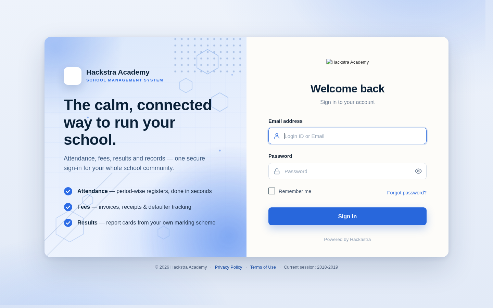
*The split-screen sign-in page — each school's name, logo and session are configured in Settings.*

</div>

---

## 📸 Screenshots

| | |
| --- | --- |
| 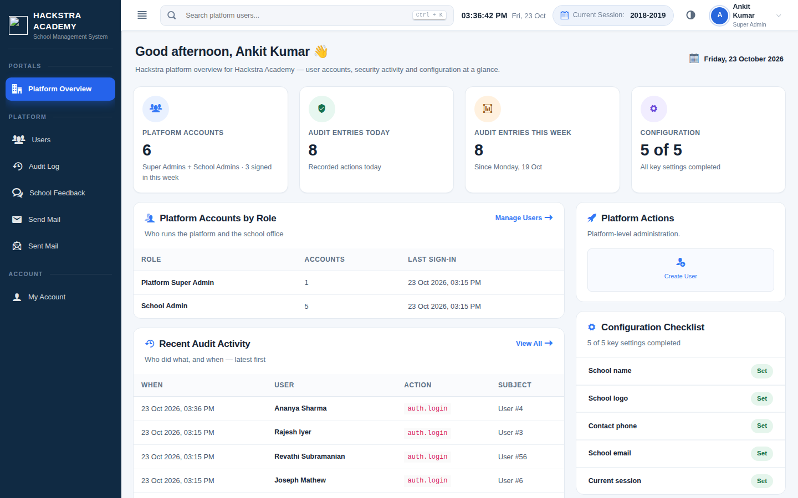 | 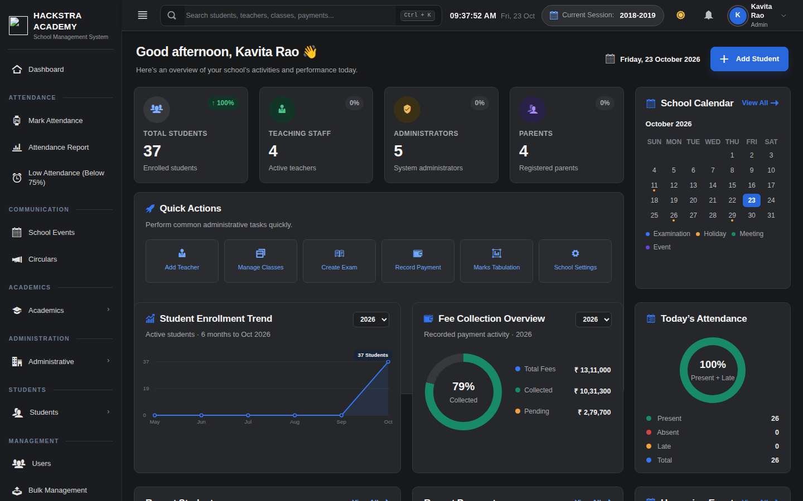 |
| **Platform Overview** — the Super Admin's cross-school command view: user accounts by role, audit activity and a configuration checklist. | **School Dashboard** — enrolment, fee collection and today's attendance at a glance, with the school calendar. |
| 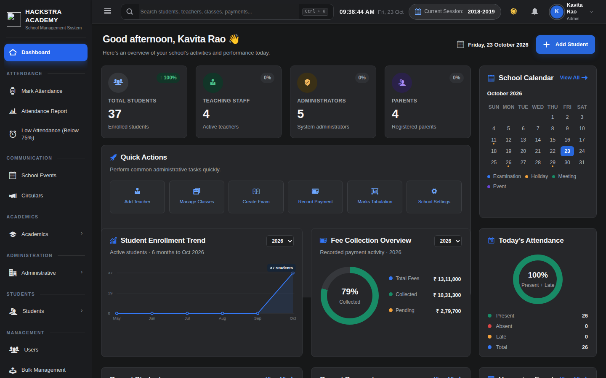 | 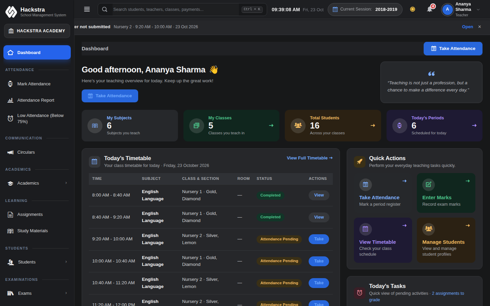 |
| **Admin Dashboard** — the school operator's daily board: totals, quick actions, enrolment trend, fee collection and attendance donut. | **Teacher Dashboard** — my subjects, my classes, today's timetable and one-tap attendance. |
| 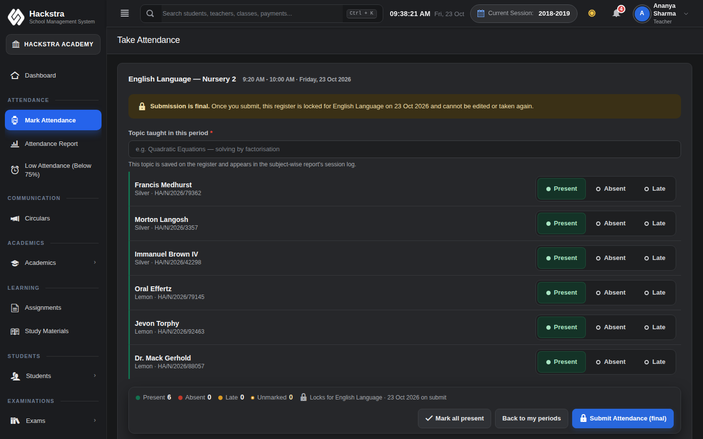 | 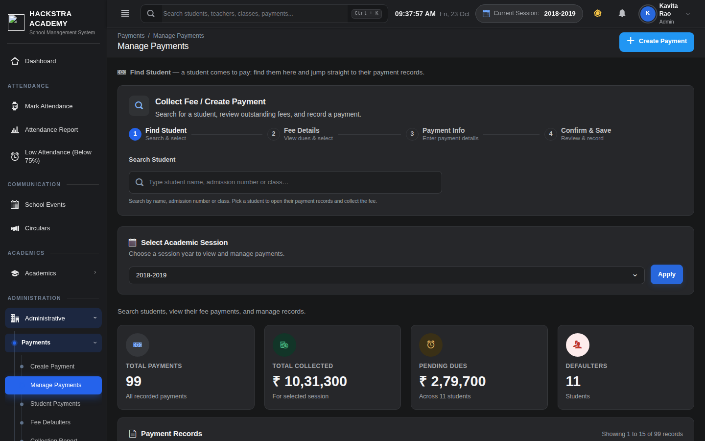 |
| **Attendance Register** — period attendance with tappable Present / Absent / Late controls, a topic-taught log and a locked, final submission. | **Collect Fee** — find any student by name, admission number or class and jump straight to their payment records. |
| 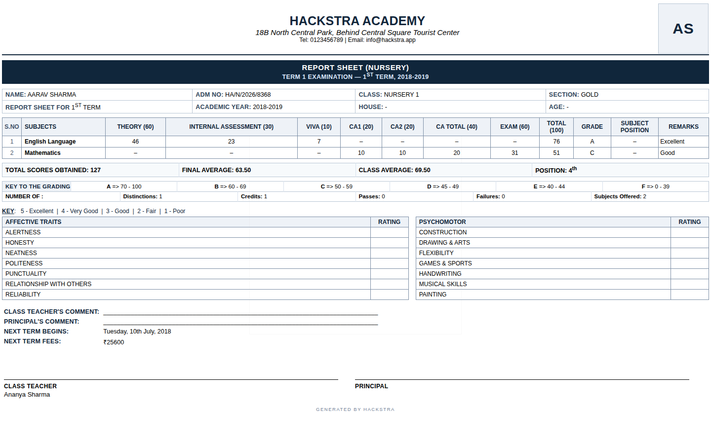 | 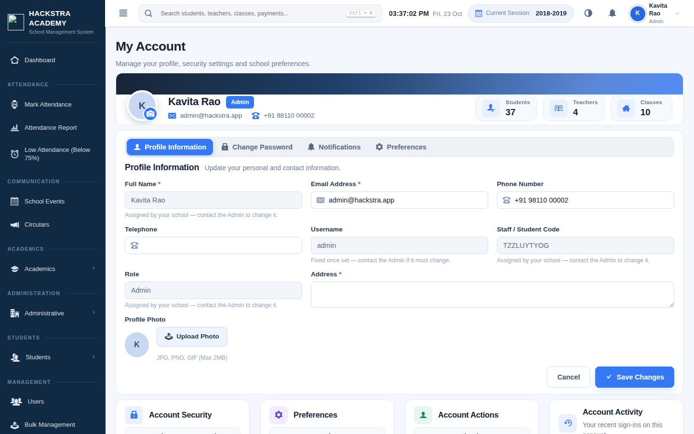 |
| **Student Marksheet** — component-wise scores (Theory / Internal / Viva) under a configurable marking scheme, ready to print. | **My Account** — one-screen profile, password, notifications and preferences, the same for every role. |
| 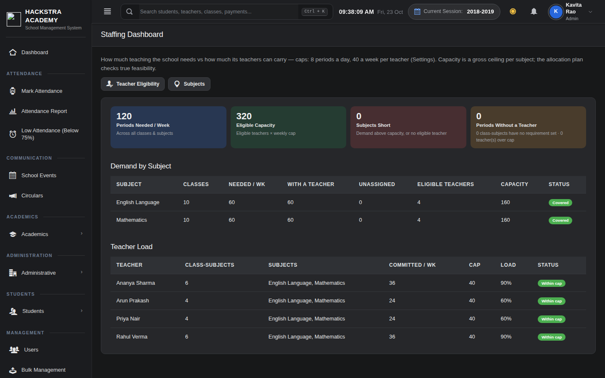 | 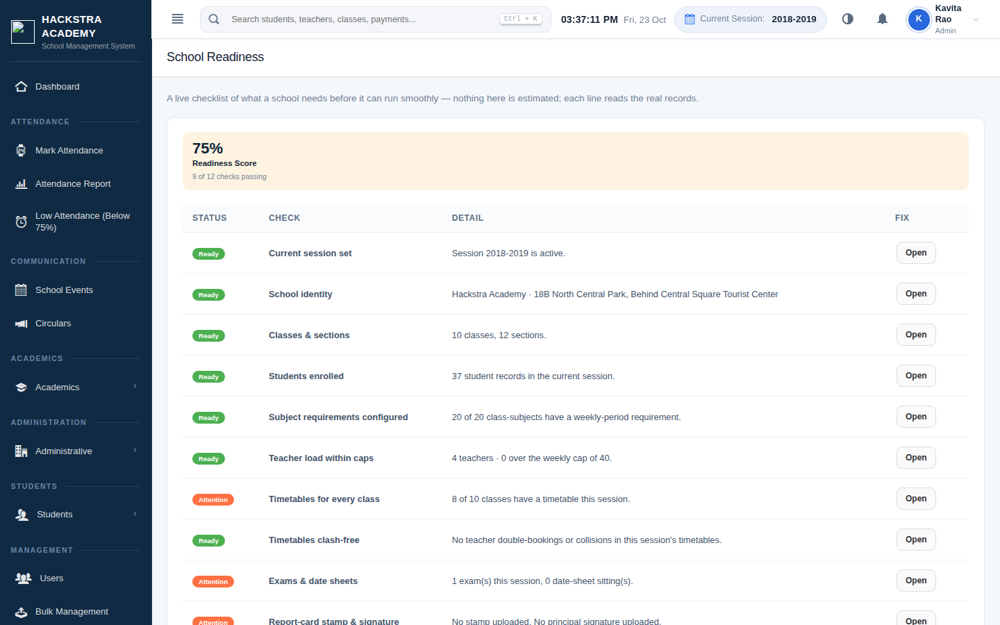 |
| **Staffing Dashboard** — periods demanded vs teacher capacity for every subject, with shortfalls and overloads computed from the school's own data. | **School Readiness** — a live checklist with a readiness score: session, enrolment, teacher load, clash-free timetables, exams and a reconciled fee ledger. |

| Mobile | |
| --- | --- |
| 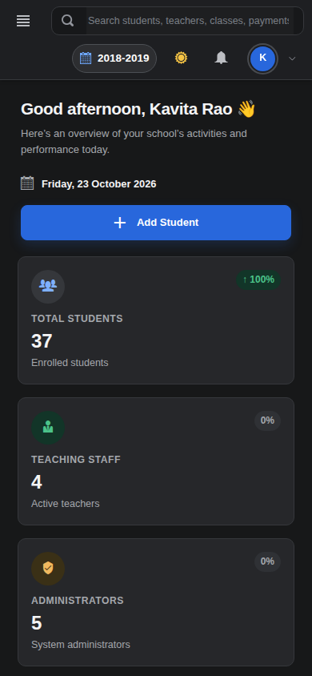 | 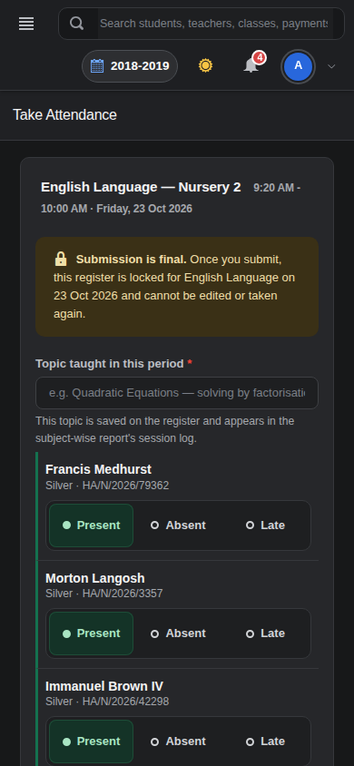 |
| *The Admin dashboard on a phone — fully responsive, no sideways scrolling.* | *Taking the register on a phone — big touch targets, same locked submission.* |

---

## ✨ Features

**Platform & roles**
- Seven role portals — Super Admin, Admin, Teacher, Student, Parent, Accountant, Librarian — each with its own home, menu and permissions
- Platform Overview for the Super Admin (platform owner) across schools, plus a per-school dashboard
- Role-based data scoping enforced on the server: a teacher sees only their own classes, a parent only their own children, an accountant only the fee office

**Students & admissions**
- Student records with photos, classes and sections
- **Quick Admit** — admit a student with just the essentials and complete the profile later
- Bulk CSV import with a downloadable template, bulk actions, promotions, graduations and printable student ID cards

**Attendance**
- Period-wise attendance register with Present / Absent / Late, topic-taught log and final locked submission
- Monthly attendance reports (screen, print and PDF from one set of figures) and a low-attendance (below 75%) list

**Exams, marks & documents**
- Exams with fully configurable marking schemes — components such as Theory, Internal Assessment and Viva, each with its own maximum, per school / exam / subject
- Marks entry with a live class summary; every mark change is written to the audit log with its old and new values
- A publish switch controls when results become visible to students and parents
- Printable term marksheets, an Annual / Cumulative Report Card, and admit cards
- **Digital documents** — the Principal's signature and the school seal are uploaded once in Settings and printed on documents automatically
- Fee defaulters' marksheets and admit cards are withheld (students & parents) until dues are cleared — and released automatically on payment

**Fees & payments**
- Collect Fee at the counter: itemised fee heads, full or part payment, instant receipt with amount in words
- **Online payment** — parents pay from their portal through the school's own Razorpay account; the money goes straight to the school, never through Hackstra
- Fee Defaulters report that prints professionally on exactly one page, a collection report with per-day breakdown, and CSV exports

**Library**
- Book catalogue, issue/return loans and student book requests, with a librarian dashboard built from the live ledger
- **Overdue fines** at a per-day rate set in Settings — a student's fine appears in their fee records automatically and clears when the fee is paid; fines can also be waived by the librarian

**Planning & scheduling**
- Subject requirements (periods per week, theory/practical, double periods) and teacher eligibility, both configured in the app — nothing hardcoded
- **Staffing Dashboard** — demand vs capacity per subject and per teacher, shortfalls and overloads from live data
- **Allocation** — reasoned teacher recommendations; eligibility is enforced on the server, and sending a teacher over the weekly cap needs an explicit, audit-logged override
- Timetable generator that hits the configured requirements exactly, plus a **validator** that hunts teacher clashes, class collisions and unmet requirements across every timetable of the year
- Exam date-sheet generator with break days between papers, and **invigilation duties** auto-assigned — balanced across teachers, never double-booked at the same date and time
- **School Readiness** — one page that scores how ready the school is (setup, enrolment, staffing, timetables, exams, fee-ledger consistency) with a fix link for every gap
- **Fee-ledger integrity** — every student's balance must recompute from their fee records; resets restore the full fee owed (never hide a defaulter) and fee definitions in use cannot be deleted

**Communication & AI**
- Circulars with audience targeting and priority levels (print + PDF), a notification bell, and platform mail
- **Ask Hackstra** — an AI assistant that answers school questions from the school's own knowledge base and circulars, with citations, scoped to what the asker's role is allowed to see
- School feedback inbox for parents and students, forwarded to the platform owner

**Office & insight**
- Role-personal timetables, staff payroll with printable one-page payslips (single or combined PDF)
- A full audit log of security-relevant actions (logins, payments, deletions, mark changes with values)
- Global search (Ctrl + K), dark mode by default, and professional print layouts with the school header on every document

---

## 🛠 Tech stack

- Laravel 12 · PHP 8.4 · Blade · Bootstrap 4 (Limitless) + a custom design system
- MySQL / MariaDB in production; SQLite used for local development
- Docker images for demo (bundled database) and production (external MySQL)
- Razorpay for online fee payment (each school connects its own account)

## 🚀 Running it

### Demo (single container, Render-style)

```bash
docker build -f Dockerfile.render -t hackstra-demo .
docker run -p 8080:80 -e APP_KEY=<your-app-key> hackstra-demo
```

The demo image bundles its own MariaDB and re-seeds demo data on every start — data is intentionally ephemeral.

### Production (Docker + external MySQL)

```bash
docker build -t hackstra .
docker run -p 8080:80 \
  -e APP_KEY=<your-app-key> -e APP_ENV=production -e APP_DEBUG=false \
  -e DB_HOST=<mysql-host> -e DB_DATABASE=<db> -e DB_USERNAME=<user> -e DB_PASSWORD=<pass> \
  hackstra
```

Migrations run automatically on boot. Set `SEED_DEMO=true` **only** for demos — never on a real school deployment. See [docs/DEPLOYMENT.md](docs/DEPLOYMENT.md) for the full Railway/Render walkthrough.

### Local development

```bash
composer install
cp .env.example .env
php artisan key:generate
php artisan migrate --seed
php artisan serve
```

## 🔑 Demo logins

Available after seeding (`php artisan db:seed`, or any `SEED_DEMO=true` deployment). **Demo-only — change or remove every one before real use.**

| Role | Email | Password |
| --- | --- | --- |
| Super Admin | superadmin@hackstra.app | hackstra |
| Admin | admin@hackstra.app | hackstra |
| Principal (school head) | principal@hackstra.app | hackstra |
| Teacher | teacher@hackstra.app | hackstra |
| Parent | parent@hackstra.app | hackstra |
| Accountant | accountant@hackstra.app | hackstra |
| Librarian | librarian@hackstra.app | hackstra |
| Student | student@hackstra.app | hackstra |

The demo school is **Hackstra Academy**. Additional sample accounts are also seeded (extra teachers `teacher1–3@teacher.com`, password `teacher`; extra students, password `student`).

## 📚 Documentation

- [Deployment guide](docs/DEPLOYMENT.md) — Railway / Render walkthrough, environment and demo mode
- [Production notes](docs/PRODUCTION.md) — running Hackstra for a real school
- [Case study](docs/CASE_STUDY.md) — how the product was rebuilt and verified
- [Product audit](docs/PRODUCT_AUDIT.md) — module-by-module audit of the platform
- [SaaS + AI roadmap](docs/SAAS_AI_ROADMAP.md) — the multi-school direction and the AI layer plan

## 🗺 Status

**v1.0.0** — the complete single-school platform: seven role portals, period attendance, configurable exams and marks, fees with online payment, library with fines, planning & scheduling (staffing, allocation, timetable validation, invigilation) and a School Readiness score. The live demo above runs exactly this code. Next on the roadmap: multi-school SaaS (one platform, many schools) — see the roadmap doc.

## 🔒 Security

If you discover a security vulnerability in Hackstra, please report it privately to the project owner before publicly disclosing it. Do not include passwords, tokens, or private student data in a public issue. See [SECURITY.md](SECURITY.md).

## 📄 License & ownership

Hackstra is released under the MIT License — see [LICENSE](LICENSE).

© Ankit Kumar. Developed and maintained by Ankit Kumar.
